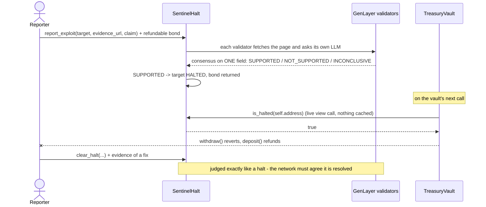

# Sentinel

**An autonomous emergency brake for GenLayer contracts.** Anyone can submit
evidence that a protected contract is under active attack; a GenLayer
validator quorum reads it independently and reaches consensus. If they agree,
the protected contract stops itself - on its very next call. No admin key, no
multisig, no token vote.

Built for GenLayer's **Autonomous Protocols** track. It answers two of the
track's briefs at once:

| Brief | How Sentinel answers it |
|---|---|
| **Emergency halt module** - "pauses a target contract when anyone proves an active exploit" | `SentinelHalt` halts a registered target when validators agree an exploit is active |
| **Contracts that govern contracts** - "one contract defines and enforces the behavior rules of another" | Any contract opts in to one rule ("do not operate while halted") with a single `is_halted(self.address)` view call; `TreasuryVault` is a working integration |

> **Status in one paragraph.** Both contracts pass `genvm-lint check` and **165 offline
> tests** (normal, adversarial and a test of the live script itself). The frontend type-checks
> and builds. **A live run on Studio has not been executed from the build environment** (no
> network access to GenLayer there); `scripts/live_e2e.py` is the one-command way to produce
> that evidence - run it, and its report is written into this README (see
> [Live end-to-end report](#live-end-to-end-report)).

---

## Why this needs decentralized judgment

"Does this page show an *active, exploitable* vulnerability in *this specific
contract*, *right now*?" is not a number you can compare against a threshold.
It means reading a block-explorer page or a security write-up and judging
whether it is about this contract, current rather than historical, and
credible rather than asserted.

Every centralized answer reintroduces the failure this track exists to
avoid:

- **One trusted reporter** can be fooled or bribed into freezing a healthy
  protocol - or a competitor's.
- **The target's own maintainer deciding** lets a compromised maintainer wave
  away a real attack to keep draining funds.
- **A token vote** is slow, and "no one voting" is the point of the category.

Independent validators each fetching the evidence and reasoning over it sit
between "nobody arbitrates" and "one party arbitrates". Their LLM wording will
never match exactly, so they only need to agree on one field: the verdict.

## How it works



| Verdict | Effect | Bond |
|---|---|---|
| `SUPPORTED` | `report_exploit`: target becomes `HALTED`. `clear_halt`: target becomes `SAFE` | returned (as credit) |
| `NOT_SUPPORTED` | nothing changes | **forfeited** to the target's maintainer as compensation for the false alarm |
| `INCONCLUSIVE` | nothing changes - evidence could not be judged | returned (as credit) |
| `RETRY_LATER` | a fetch or LLM failure, *not* a verdict; nothing is written to history | returned (as credit) |

**Clearing a halt needs the same consensus as raising one.** If a maintainer
could simply declare a compromised contract fixed, a compromised maintainer
would. That symmetry is a deliberate design choice, not an omission.

## Integrating your own contract (two lines)

Protection is opt-in and lives on the target's side. `register_target` is
permissionless and grants `SentinelHalt` no control over anything - registering
an address that never asks is harmless bookkeeping. A contract protects itself
by asking, on every sensitive call:

```python
@gl.contract.interface
class _SentinelHalt:
    class View:
        def is_halted(self, target: str) -> bool: ...
    class Write: ...

# inside any method that should freeze during an exploit:
if _SentinelHalt(self.sentinel).view().is_halted(str(self.address)):
    raise gl.vm.UserError("halted by SentinelHalt")
```

`TreasuryVault` does exactly this in `deposit()` and `withdraw()`. It **fails
closed**: if the oracle can't be reached it treats itself as halted, because a
broken safety check should never silently become "no safety check".

## Contracts

| Contract | Methods | Role |
|---|---|---|
| `contracts/SentinelHalt.py` | 20 (9 view, 11 write) | Registry + AI-judged halt/clear authority |
| `contracts/TreasuryVault.py` | 7 (4 view, 3 write) | Minimal reference integration; a vault that enforces the halt |

**`SentinelHalt`** - writes: `register_target`, `update_scope`,
`report_exploit` *(payable)*, `clear_halt` *(payable)*, `preview_action`
(non-binding dry run), `claim_compensation`, `withdraw_credit`, and owner controls
(`set_paused`, `set_report_bond`, `set_action_cooldown_seconds`,
`transfer_ownership`). Views: `is_halted`, `get_target`, `get_targets`,
`get_report`, `get_target_reports`, `get_reporter_stats`, `get_credit`, `get_config`,
`get_stats`.

Defaults: report bond 0.01 GEN (bounded 0.0001-1 GEN), 5-minute cooldown.
The cooldown is a target-wide lock only after a *SUPPORTED* decision, plus a
per-reporter-per-target throttle after any decided report, so junk can never
block someone else's real report.

The owner can tune the bond and cooldown and pause *new* reports. The owner
**cannot** decide any target's status - that is only ever a validator
consensus - and pausing never blocks compensation claims.

### Design decisions worth knowing

- **Pull payments.** No AI-judged or payable path sends GEN out (an `emit_transfer`
  issued after a non-deterministic block was not applied on Studio). A refunded
  bond is an entry in a credit ledger; its owner pulls it with `withdraw_credit()`.
  Invariant checked live: `balance == credits_outstanding + compensation_outstanding`.
- **Only the required bond is at stake.** Anything sent on top is credited back.
- **Payable methods never `raise`.** A `gl.vm.UserError` rolls back storage but
  not the GEN that arrived with the call, stranding it. Every rejection in
  `report_exploit` and `clear_halt` credits the sender and returns
  `{"ok": false, "reason": ...}` (a malformed `target` included); `deposit` refunds. A structural test
  (`tests/direct/test_no_raise_in_payable.py`) fails the build if a `raise` ever
  appears inside a payable method.
- **Consensus on exactly one field.** Validators compare only `verdict`.
  `confidence` and `reasoning` are stored as evidence but never compared - two
  LLMs will almost never word things identically even when they fully agree.
  `_coherent()` separately checks the leader's own report for internal
  consistency (confidence in range, bounded reasoning), as a pure function of
  the leader's calldata so it can't itself cause disagreement.
- **Infrastructure failure is not a verdict.** A failed fetch, a failed LLM call,
  or unparseable LLM output raises a tagged error that is caught and turned into
  `RETRY_LATER` with the bond refunded. If both leader and validator hit the
  same class of failure they agree to settle on "retry", instead of burning a
  leader rotation. A network hiccup is never written to a target's permanent
  history as a wrong verdict.
- **Dynamic evidence pages.** Fetched with `wait_after_loaded="3s"` so
  JS-rendered block explorers are captured after they paint, not as an empty
  shell.
- **Cheap to abuse is expensive here.** A bond plus a per-target cooldown stop
  anyone from spamming validators and LLM calls.

## What is and isn't verified

Verified in the build environment (re-runnable - see [Quick start](#quick-start)):

| Check | Result |
|---|---|
| `genvm-lint check` on both contracts (lint + SDK validation) | passes, exit 0 |
| Direct Mode tests (`tests/direct/`) | **165 pass**, from a cold cache and warm |
| Payable-never-raises structural test | passes for every payable method |
| Frontend `tsc --noEmit` and `next build` | pass |
| Frontend end-to-end in headless Chromium, real Transaction Kit panel, simulated chain | register -> fund -> halt -> clear -> withdraw all work; zero console errors; no horizontal overflow at 390px |
| Deploy scripts type-checked against the installed `genlayer-js@2.0.0-rc.1` | pass |

**Not verified - needs a funded Studio Devnet account:**

| Gap | Why it matters |
|---|---|
| **Live deployment** | Never run. If the network's GenVM release doesn't contain the runner the contracts pin, deploy fails - see [The runner hash](#the-runner-hash-read-this-before-deploying). |
| **`tests/integration/`** | Written against gltest's documented Studio Mode API; never executed. It is the only test that proves `TreasuryVault` genuinely reaches a real `SentinelHalt`. |
| **Real validator/LLM behavior** | The prompt has been exercised only with mocked LLM responses. How a live model judges real evidence pages is untested. |
| **Fee profile** | `frontend/public/fee-profile.json` is intentionally absent: fee numbers have to be measured on a live network, and inventing them would be worse than none. The Transaction Kit falls back to network-default allocations. |
| **The frontend's live mode** | Reads use `genlayer-js`'s `readContract`; writes go through the Transaction Kit. Type-checked, but only the simulated mode has been driven in a browser. |

### Test-harness limitations (not contract bugs)

`genlayer-test 0.30.0rc2`'s Direct Mode has gaps, each confirmed by reading its
source or reproducing it, and each worked around in the *test* code only:

- `gl.vm.get_timestamp()` returns `None` -> `tests/direct/conftest.py` patches it
  with a controllable fake clock (the contracts correctly treat a missing clock
  as unavailable and refuse to act).
- Cross-contract `CallContract` requests aren't routed to a second deployed
  contract -> `TreasuryVault._halted` is patched at the class level in its unit
  tests, and the real end-to-end path is left to `tests/integration/`.
- A mocked LLM reply that is valid JSON is pre-parsed into a dict before the SDK's
  own parser sees it, which makes `response_format="json"` untestable -> the
  contract uses text mode plus its own tolerant `_clean_json` parser (the
  two-layer approach the SDK docs recommend anyway), and tests wrap the mocked
  JSON in a markdown fence.
- Payable `value` is set via `direct_vm.value`, and a contract's balance is not
  credited automatically -> helpers and `direct_vm.deal` cover both.

## Quick start

Requires Python 3.12+ and Node 22+.

### 1. Run the tests (no network account, no private key)

```bash
pip install -r requirements-dev.txt
python -m pytest tests/direct          # 165 tests
genvm-lint download --version v0.6.0-rc9   # once, so the linter can find the runner
genvm-lint check contracts/SentinelHalt.py
genvm-lint check contracts/TreasuryVault.py
```

The first test run downloads the GenVM runtime (~300 MB); later runs take a few
seconds.

### 2. Try the interface (no wallet, no network)

```bash
cd frontend
npm install
npm run dev        # http://localhost:3000
```

With no contract addresses configured it opens in a clearly-labelled
**simulated demo**: a ribbon says so, and verdicts come from a keyword
heuristic, not validators, and every simulated reasoning string says
`[demo heuristic]`. The transaction panel is the real
`@genlayer/transaction-kit-react` one, running on its mock kit. To see a halt,
register, deposit, then file a report whose claim mentions *drain* or
*exploit*.

### 3. Deploy to Studio Devnet

```bash
cd deploy
cp .env.example .env          # add a FUNDED DEPLOYER_PRIVATE_KEY
npm install
npm run deploy                # quotes fees, deploys both, writes deployments.json
npm run check                 # read-only wiring check, no key needed
```

Then put the two printed addresses in `frontend/.env.local`
(`NEXT_PUBLIC_SENTINEL_ADDRESS`, `NEXT_PUBLIC_VAULT_ADDRESS`) and restart the
frontend; it switches to live mode and asks you to connect a wallet.

### 4. Run the live integration test

```bash
cp gltest.config.example.yaml gltest.config.yaml
cp deploy/.env.example .env
gltest tests/integration --network studio_devnet -v
```

## The runner hash (read this before deploying)

Each contract pins one exact GenVM Python runner in its first line:

```python
# { "Depends": "py-genlayer:babwp9t37jw9g4j2bccgn14g6x7x9s1f7dsmh7emvz735pz4zxa0" }
```

A network only accepts a contract whose runner it knows, and the hash differs
between GenVM releases (`v0.6.0-rc3` uses `5jycge...`; the `v0.6.0-rc9` and
`-rc10` bundles - byte-identical - use `babwp9...`). This repo pins the latter
because it is the newest release published at build time, but **it could not
be confirmed against what Studio Devnet is actually running.**

If your deploy is rejected over the runner, run
`python3 scripts/set_runner_hash.py --show`, find the runner your network
expects, and switch both contracts at once with
`python3 scripts/set_runner_hash.py <new-hash>`. Then update
`GENVM_RUNTIME_VERSION` in `tests/direct/conftest.py` to the matching release.
The tests pin their runtime that way on purpose: without it, an unreachable
GitHub API makes gltest silently fall back to an *older* release and nearly
every test errors at setup.

## Network notes

- The hackathon brief names the network "Studio Next" with RPC
  `https://studio-next.genlayer.com/api`. `genlayer-js@2.0.0-rc.1` ships this
  chain as `studioDevnet` (id **61997**, RPC `https://studio-dev.genlayer.com/api`),
  and the chain id matches the brief; this repo uses the SDK's definition. I
  could not confirm from here that the `studio-next` host serves the same
  chain.
- The v0.6 fee model means every deploy and write carries a quoted fee, unlike
  the older gasless Studio. The deploy scripts quote first (`estimateTransactionFees`)
  and the frontend delegates all of it to the Transaction Kit panel.
- For payable calls the Transaction Kit takes the GEN amount as a separate
  `userValue` prop - it is not part of `tx` - which is how the bond and the
  deposit amount are sent.
- Explorer: https://explorer-studio-dev.genlayer.com/

## Mapping to the hackathon review questions

| Question | Answer |
|---|---|
| Does the app call a real GenLayer contract? | In live mode, yes: `genlayer-js` `readContract` for state and the Transaction Kit for writes. Simulated demo mode is separate and badged. *Live mode is not yet exercised against a deployed contract.* |
| Why does decentralized judgment matter? | [Above](#why-this-needs-decentralized-judgment). |
| Meaningful state, and does the validator check the meaningful outcome? | State: targets and status, a per-target report history, reporter track records, bonds and accrued compensation. Validators fetch the evidence and reach consensus on the verdict - the outcome that decides the halt - while the leader's report is also checked for internal coherence. |
| Does the repository build and work? | CI runs the contract lint/validation, 165 tests, the frontend type-check and build, and the deploy-script type-check. |
| What is built beyond the starter? | Everything here. Note: the brief suggests cloning the boilerplate's `v2-dev` branch; that repo's pages couldn't be fetched from the build environment, so this app was built on the same stack (Next 15, TanStack Query, `genlayer-js@2.0.0-rc.1`, `@genlayer/transaction-kit(-react)@0.1.0-rc.2`) and the same layout (`contracts/`, `tests/direct`, `tests/integration`, `frontend/`, `deploy/`, CI) rather than from a clone. |
| Can someone use the frontend and verify the result? | The page's own "Verify it yourself" checklist walks a reviewer through register -> fund -> report -> watch the withdrawal revert -> clear. |

## Layout

```
contracts/            SentinelHalt.py, TreasuryVault.py
tests/direct/         165 offline tests (Direct Mode) + conftest with the harness workarounds
tests/integration/    live Studio Devnet test (written, not yet run) + its README
frontend/             Next.js 15 app: live mode + simulated demo mode
deploy/               TypeScript deploy + read-only check scripts (genlayer-js v2)
scripts/              set_runner_hash.py
gltest.config.example.yaml   copy to gltest.config.yaml for the live test only
requirements-dev.txt  pinned release-candidate tooling
.github/workflows/    CI
```

## License

MIT - see [LICENSE](LICENSE).

## Audit notes (what the debugging pass found and fixed)

| # | Finding | Fix |
|---|---|---|
| 1 | **Validators could never agree on a shared outage.** A leader's `UserError` reaches a validator as an exception carrying `.data`; the contract read `.message`, so the agree-on-`RETRY_LATER` path was dead code on a real network. Direct Mode never ran that branch. | `_error_text()` reads `.data`/`.message`; regression tests replay the validator side with `run_validator`. |
| 2 | **Cooldown could block a real halt.** Any decided report (even junk) started a target-wide cooldown, and a registrant gets forfeited bonds back, so a squatter could keep a target un-haltable. | Only `SUPPORTED` starts the target-wide cooldown; a per-reporter throttle limits spam. |
| 3 | **Refunds were push transfers** after a non-deterministic block, which was not applied on Studio (seen live on a sibling project): bonds would sit in the contract while storage said "returned". | Credit ledger + `withdraw_credit()`. |
| 4 | A malformed `target` string raised from a payable path, stranding the bond. | Parsed without raising; refunded as credit. |
| 5 | A global "time since last outbound transfer" gate on `claim_compensation` could be reset by anyone. | Removed; claims are bounded by what was accrued. |
| 6 | Over-payment was forfeited in full on a false alarm. | Only the required bond is staked. |
| 7 | Evidence, claim and scope were concatenated raw into the LLM prompt. | Fenced as untrusted data with an explicit notice; forged fences are defanged. |
| 8 | `TreasuryVault` failed open when the oracle returned `None`/`0`. | Only an explicit `False` opens the vault. |
| 9 | `confidence: true` passed the coherence check (`bool` is an `int`). | Rejected. |

Known limitations, deliberately not changed: registration is first-come-first-served, so a
squatter can register an address they do not own (this gives them no power over it; a
protected contract's own `is_halted` check is what matters); an attacker can still try to sway
an LLM, which is why a verdict needs validator consensus and why every hostile case is also run
live. The frontend does not yet have a *Withdraw credit* button.

## Live end-to-end report

About 30-60 minutes on a Studio network (real validators and LLM, faucet-funded fresh accounts):

```bash
pip install -r requirements-live.txt
python scripts/live_e2e.py --update-readme   # Studio Next (chain 61997) is the default
```

Push the branch first: the evidence pages are served from `fixtures/evidence/` through
`raw.githubusercontent.com` (public repo). The report is written to
`reports/live-e2e-latest.md`, to the Actions job summary, and into the block below.

<!-- LIVE_E2E_REPORT:START -->
_Not run yet._
<!-- LIVE_E2E_REPORT:END -->
